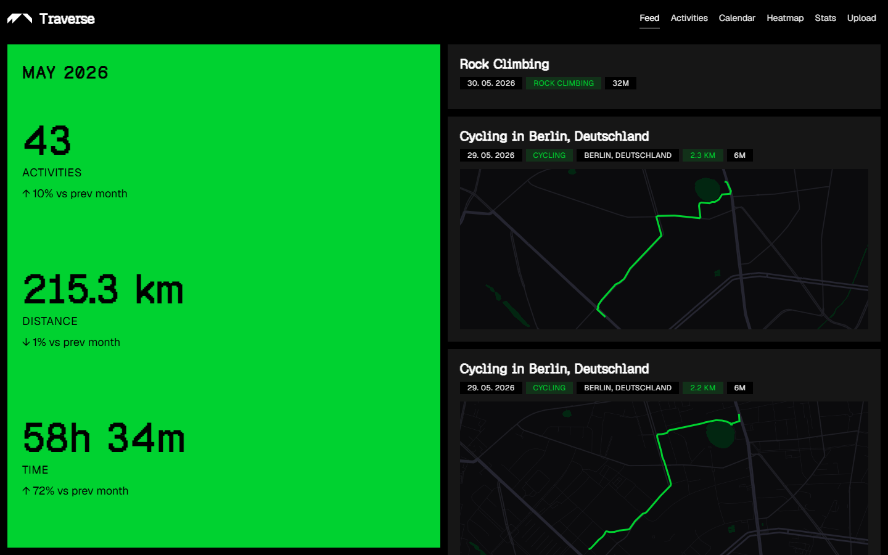
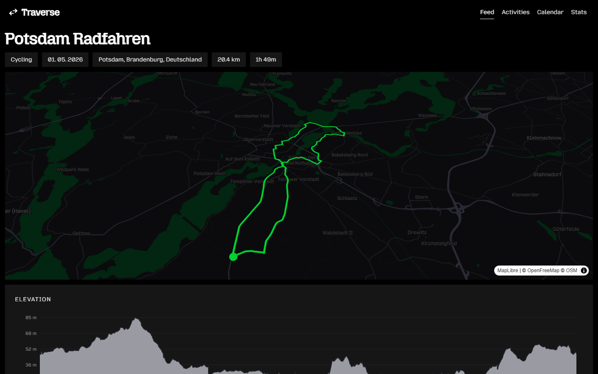
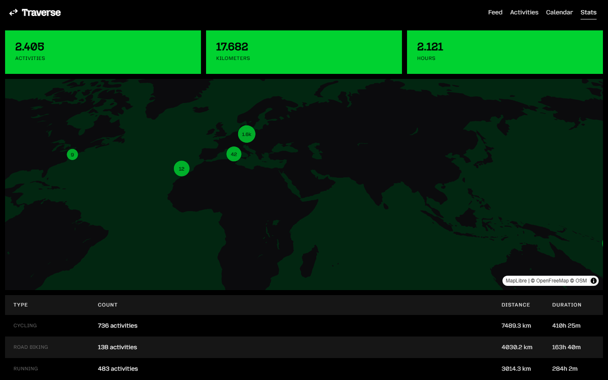
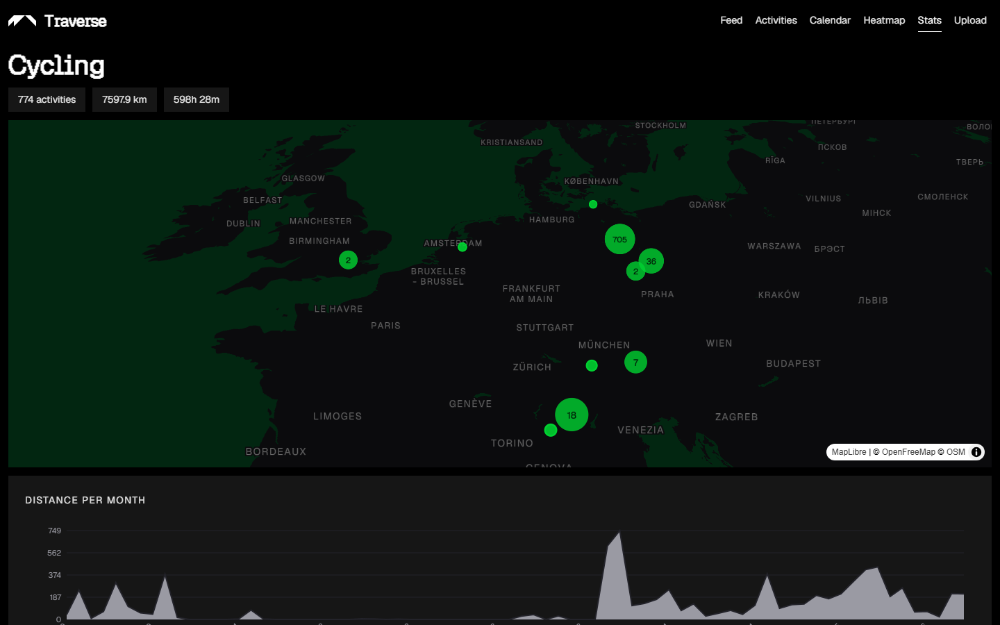

# Traverse

Self-hosted viewer for FIT/GPX/TCX activities.






## Setup

```
npm install
```

## Usage

### Build the index

```
npm run build:index
```

Builds generated artifacts:

- `activity-index.json` (activity index for the viewer)
- `heatmap-data.json` (precomputed heatmap points by activity type)
- `track-tiles/` (pre-rendered overview tiles and vector route tiles)

During indexing:

- FIT, GPX, and TCX files are used for route/track points and heatmap generation.
- The Heatmap page has a Tracks view. It draws every GPS route using cached map tiles; short routes are retained in the overview tiles. The activity-type filter works in both views.
- Duration/HR/calories are taken from FIT, GPX, or TCX data.

Activity locations are reverse geocoded via OpenStreetMap Nominatim. Results are cached, so only new activities get geocoded on subsequent runs.

### Start the viewer

```
npm start
```

Opens `http://localhost:3000` with:

- Searchable, filterable activity list
- Activity detail pages with map and stats
- Stats overview with world map (clustered) and per-type breakdowns with charts

## Goals

Open `/goals` to create goals organised into categories (Endurance and Strength by default) and optional groups such as Winter Arc.

- Automatic measurements: training hours, total distance, activity count, or longest activity. Choose Garmin sport filters and either a weekly target or a whole date range.
- Weeks start on Monday in Europe/Berlin. Training time uses FIT timer duration when available, falling back to the existing elapsed duration.
- Manual benchmarks have a date and an optional Garmin activity link. Linked benchmarks use the activity date; standalone benchmarks do not create activities. Skill goals use named milestones. Goals do not create or modify activities.
- Categories can be added, renamed, removed and restored. Removing a populated category moves its goals (including archived ones) to a chosen category and preserves their progress. Goals can be archived and restored.
- The feed summary uses one set of dots: monthly stats first, then movement and health snapshots when wellness data is available, followed by goal pages. Swipe horizontally, drag, or use a horizontal trackpad gesture to switch pages. Pages follow the drag with a gap between them, then slide into place or snap back; reduced-motion preferences are respected. Text selection is disabled in this card. Vertical scrolling and pinch zoom remain available. On desktop it fits the viewport height; the number of goal pages adapts to the available space without an internal scrollbar.
- Goals, categories, benchmarks and milestones are stored in `DATA_DIR/goals.json` using serialised atomic writes, independently of the generated activity cache. Include this file in your data-volume backups.

Newly indexed FIT activities retain `sport`, `subSport` and `timerDuration`. To add those fields to older cached activities, run `npm run build:index:force` against your existing activity files. Exact subtype filters exclude older activities without subtype metadata; selecting the broad Training filter includes all Training activities.

The application relies on the existing Tailnet access boundary; Goals does not add a login.

### Local Goals demo

Set `TRAVERSE_DEMO_DIR` to an absolute scratch directory and run `node scripts/demo-goals.js`. It reads the activity list from `https://traverse.philippfrom.me`, stores a separate snapshot and example Winter Arc goals in the scratch directory, then serves the demo at `http://localhost:4174/goals`. The source activities and homeserver are never written by the demo. Set `TRAVERSE_DEMO_SOURCE` or `PORT` to override the source URL or demo port. Existing demo goals are preserved on restart.

Run the goal calculation, persistence, overview pagination and gesture checks with `node --test viewer/goals.test.js viewer/feed-goals-pagination.test.js viewer/feed-summary-gestures.test.js`.

## Health

Open `/health` for a daily Garmin wellness overview and 7-, 30-, 90-, 180-, or 365-day trends. Click the displayed date to choose any saved day from a calendar, use the date arrows, or select a trend bar. Longer ranges group readings into weekly or monthly daily averages. Missing measurements appear as a dash; a missing day is not counted as zero.

The page reads `DATA_DIR/wellness/YYYY-MM-DD.json` files produced by the `garmin-download` project. Put that project's `data/wellness` directory in Traverse's data volume (the supplied Docker configurations mount the same directory). No index rebuild is needed when new wellness files arrive. The `/health` JSON liveness response remains available to clients that do not request HTML.

Run the health API checks with `node --test viewer/health.test.js`.

## Races

Open `/races` to plan running races for any season. Add a name, date (or a tentative date window), and distance; optionally record a target time, registration status, location, organiser link and notes. Races can be edited, archived and restored. The optional **Berlin 2027 ideas** dialog previews six organiser-linked events before adding them; repeated imports preserve existing entries, including edited and archived ones.

- Choose one upcoming race as your training target. The next race is shown independently, so a closer side event does not replace your main goal. Nearby races within 14 days are flagged for planning.
- The season timeline uses the reference's 24-week preparation windows. Races over 10 km use 12/6/4/2 weeks for Base/Build/Race-specific/Taper; shorter races use 16/4/3/1. Tentative race windows remain labelled tentative.
- Running statistics come from the current activity index, counting each running activity ID once. They use completed Monday–Sunday weeks in Europe/Berlin, include zero-run weeks, and exclude missing distances from kilometre totals. Refresh or refocus the Races page to load the latest index. The displayed latest activity date makes an old index visible.
- Weekly suggestions distribute your selected volume over two to five days, defaulting to the last complete running week. Taper uses 65% of that volume. These are general planning suggestions without automatic mileage increases or pace predictions; no normal week is suggested on race day or for past targets.
- Link an existing completed running activity to show its recorded result beside the plan. Race outcome is set explicitly. Missing activity links remain visible and can be repaired. Planning does not create or modify activities or contribute to Goals.
- Calendar shows race markers separately from activities and lets you add a race from a selected day. Its year selector includes future race years; both race and activity dates use Europe/Berlin. The feed overview includes a Races page in the same set of swipeable dots.
- **Export calendar** downloads the season as ICS with stable event IDs and tentative multi-day windows where needed. It does not synchronise with Garmin Connect or subscribe an external calendar.

Races and planning settings are stored in `DATA_DIR/races.json` using serialised atomic writes. Include this file in data-volume backups. The existing Tailnet access boundary applies. No race data is populated until you add or import it.

Run the race calculations, persistence, API and calendar-export checks with `node --test viewer/races.test.js`.

## Docker

A Docker image is published to GitHub Container Registry when a version tag is pushed (e.g., `git tag v1.0.0 && git push --tags`).

### Pull and run

```
docker run -d \
  -p 3000:3000 \
  -v /data/traverse:/app/data \
  ghcr.io/philippfromme/traverse:latest
```

Your data directory should contain:

```
/data/traverse/
  fit/                  FIT files
  gpx/                  GPX files
  tcx/                  TCX files
  wellness/             Daily Garmin wellness JSON files
  activity-index.json   Generated on first start (persisted automatically)
  heatmap-data.json     Generated on first start (persisted automatically)
  track-tiles/          Generated on first start (persisted automatically)
```

The server builds `activity-index.json`, `heatmap-data.json`, and track tiles automatically on first start if they don't exist. On subsequent starts, only new activity files are parsed; track tiles are rebuilt from cached route geometry when activities change.

Drop new FIT, GPX, or TCX files into the mounted data directories and the index rebuilds automatically within a few seconds — no restart needed.

### Build locally

```
docker compose up --build
```

Or manually:

```
docker build -t traverse -f docker/Dockerfile .
docker run -d -p 3000:3000 -v /path/to/data:/app/data traverse
```

## Releasing

```
npm run release
```

Uses [np](https://github.com/sindresorhus/np) to bump the version, create a git tag, and push. The GitHub Action then builds and publishes the Docker image to GHCR.
